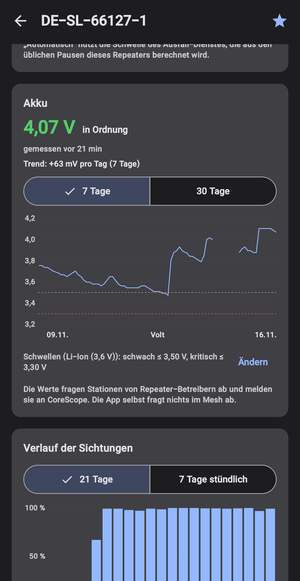
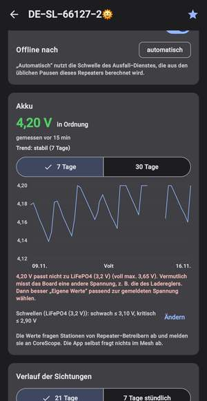

# SaarMesh Repeater-Wächter

Der Repeater-Wächter ist eine Android-App für alle, die im **SaarMesh** (MeshCore, LoRa auf 869,618 MHz,
Region SaarLorLux) einen Repeater betreiben oder betreuen. Sie zeigt dir auf einen Blick, welche Repeater
gerade erreichbar sind, und meldet sich, wenn einer deiner Repeater ausfällt oder sein Akku schwach wird.

Die App liest nur öffentliche Daten von [live.saarmesh.de](https://live.saarmesh.de). Sie sendet nichts ins
Mesh und ändert keine Einstellungen an Repeatern.

## Funktionen

- **Repeater-Liste** mit Suche und Filtern (Status, Region, „Meine“), Anzeige „zuletzt gesehen vor …“
- **Meine Repeater:** Du markierst die Repeater, die dich interessieren, mit einem Stern.
- **Detailansicht:** Status mit Erklärung, Verlauf der letzten Wochen, Karte und Links zu den passenden
  Seiten auf live.saarmesh.de
- **Benachrichtigungen,** wenn einer deiner Repeater ausfällt und wenn er wieder da ist. Ab wann ein
  Repeater als ausgefallen gilt, kannst du pro Repeater einstellen.
- **Akku-Anzeige,** sofern für den Repeater Akkuwerte vorliegen: aktuelle Spannung, Verlauf, Trend und
  eine Warnung bei schwachem Akku. Den Akku-Typ (Li-Ion, LiFePO4, Inhero MR2, Netzteil oder eigene
  Schwellen) stellst du pro Repeater ein.
- **Widget** für den Startbildschirm mit einer Ampel für deine Repeater
- funktioniert auch ohne Netz mit den zuletzt geladenen Daten, mit hellem und dunklem Design

## Screenshots

| Akku-Verlauf eines Solar-Repeaters | Hinweis bei unpassendem Akku-Typ |
|---|---|
|  |  |

Screenshots der Liste und des Widgets folgen.

## Installation

Voraussetzung ist ein Android-Gerät ab **Android 8.0**. Google-Dienste brauchst du nicht.

1. Öffne die Seite [Releases](https://github.com/SaarMesh-de/saarmesh-repeater-waechter/releases/latest)
   und lade die Datei `repeater-waechter-vX.Y.Z.apk` herunter.
2. Öffne die Datei auf dem Handy. Android fragt beim ersten Mal, ob dein Browser oder Dateimanager Apps
   installieren darf. Erlaube das für diese Installation.
3. Für ein Update lädst du die neue APK genauso herunter und installierst sie über die alte Version.
   Deine Einstellungen und Favoriten bleiben dabei erhalten.

## Benutzung

1. **Repeater auswählen:** Tippe in der Liste auf den Stern neben deinen Repeatern. Sie stehen dann oben
   in der Liste, im Filter „Meine“ und im Widget.
2. **Benachrichtigungen erlauben:** Die App fragt beim Start danach (ab Android 13). Ohne diese Erlaubnis
   gibt es keine Meldungen bei Ausfall oder schwachem Akku.
3. **Schwelle für „offline“ einstellen (optional):** Öffne einen Repeater. Unter „Offline nach“ wählst
   du „automatisch“ oder eine feste Zeit. „Automatisch“ richtet sich nach den üblichen Pausen dieses
   Repeaters und passt für die meisten Fälle.
4. **Akku-Typ einstellen (optional):** Wenn die Detailansicht eines deiner Repeater eine Akku-Karte zeigt,
   tippe dort auf „Ändern“ und wähle den passenden Typ. Bei einem Repeater am Netzteil wählst du
   „Kein Akku“.
5. **Widget hinzufügen:** Lange auf den Startbildschirm tippen → Widgets → Repeater-Wächter →
   „Meine Repeater“.
6. **Einstellungen:** Dort legst du fest, wie oft die App im Hintergrund nachsieht (ab 15 Minuten).
   Außerdem kannst du alle Benachrichtigungen abschalten.

**Was bedeuten die Farben?**

| Farbe | Status |
|---|---|
| grün | online, in der üblichen Zeit gesehen |
| orange | überfällig, länger still als üblich |
| rot | offline, vermutlich ausgefallen |
| blau | unklar, weil die Empfangsstationen in der Nähe selbst gerade keine Daten liefern |
| grau | ersetzt (neu geflasht) oder zu wenige Daten |

Wie live.saarmesh.de den Status berechnet, steht auf der Seite
[Repeater-Ausfälle](https://live.saarmesh.de/ausfall/) unter „Wie wird gerechnet?“.

**Warum hat mein Repeater keine Akku-Anzeige?** Repeater senden ihre Akkuspannung nicht von sich aus.
Jemand muss sie gezielt abfragen und an live.saarmesh.de weitergeben. Liegen für einen Repeater keine
Werte vor, bleibt die Akku-Karte einfach weg. Betreibst du einen Repeater auf Akku oder Solar und nutzt Home
Assistant? Dann kannst du die Werte selbst einliefern: [Akkuwerte melden](docs/TELEMETRIE-STATION.md).

## Datenschutz

- Die App ruft nur öffentliche Daten von **live.saarmesh.de** ab: die Liste der Repeater mit ihrem Status,
  den Sichtungsverlauf eines Repeaters und, für deine Favoriten, die Akkuwerte.
- Für die Karte lädt sie Kartenkacheln von **OpenStreetMap**.
- Die App hat **kein Konto, keine Werbung und kein Tracking**. Deine Favoriten und Einstellungen bleiben auf
  deinem Gerät.
- Die App kann nichts ins Mesh senden. Sie hat keinen Zugriff auf Bluetooth, USB oder dein Funkgerät.
- Die Server-Adresse kannst du in den Einstellungen ändern. Standard ist `https://live.saarmesh.de`.

## Lizenz und Kontakt

Die App steht unter der [MIT-Lizenz](LICENSE).

Fragen, Fehler oder Ideen: Melde dich über [saarmesh.de](https://saarmesh.de) oder öffne ein
[Issue](https://github.com/SaarMesh-de/saarmesh-repeater-waechter/issues).

Wenn du an der App mitarbeiten möchtest, findest du alles Nötige in [CONTRIBUTING.md](CONTRIBUTING.md).

---

### English summary

**SaarMesh Repeater-Wächter** ("repeater watcher") is an Android app for operators of repeaters in the
SaarMesh MeshCore network (LoRa, 869.618 MHz, Saarland, Lorraine and Luxembourg). It shows which repeaters
are currently reachable. It notifies you when one of your repeaters goes offline, comes back, or runs low
on battery. A home-screen widget shows a traffic light for your repeaters. The app only reads public data
from [live.saarmesh.de](https://live.saarmesh.de) and never transmits anything into the mesh.

Install it from the [latest release](https://github.com/SaarMesh-de/saarmesh-repeater-waechter/releases/latest)
(APK, Android 8.0 or later, no Google services required). The app is currently available in German only.
A French version is planned.
